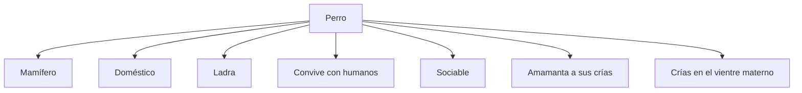
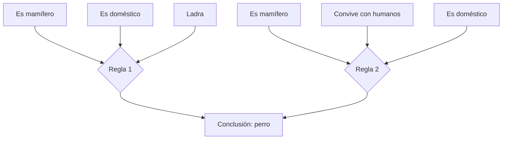

# Ontologia del perro

## 1. Descripcion

Esta ontologia representas las respuestas que mediante una entreviste obtenida, nos dan la base de la informacion para crear las condiciones,hechos y reglas

## 2. Hechos formalizados

Los hechos se representan mediante predicados asociados al individuo perro.

- `mamifero(perro)`
- `domestico(perro)`
- `ladra(perro)`
- `convive_humanos(perro)`
- `sociable(perro)`
- `amamanta_crias(perro)`
- `crias_vientre_materno(perro)`

## 3. Representación grafica de los hechos

## 4. Reglas de conocimiento

### Regla 1

Si el individuo es mamífero, doméstico y ladra, se concluye que corresponde al concepto perro.

**Formalizacion:**

`perro(X) :- mamifero(X), domestico(X), ladra(X).`

### Regla 2

Si el individuo es mamífero, convive con los seres humanos y es domestico, se concluye que corresponde al concepto perro.

**Formalización:**

`perro(X) :- mamifero(X), convive_humanos(X), domestico(X).`

## 5. Representacion grafica de las reglas

## 6. Relacion con el programa Python

Los hechos se almacenan mediante tuplas y las reglas se representan mediante tuplas que contienen una conclusión y sus condiciones.

El programa utiliza la funcion `all()` para comprobar si todas las condiciones de cada regla se encuentran en la base de hechos. 

## 7. Conclusion

La ontologia nos permite organizar graficamente el conocimiento obtenido en la entrevista. Los hechos describen las caracteristicas del perro y las reglas permiten evaluar las condiciones para obtener conclusiones mediante Python.
